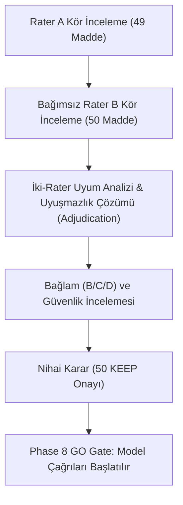

# Proje Durum Özeti ve İlerleme Planı (Session Handoff)

**Tarih:** 2026-08-29  
**Protokol:** `LLM-CTX-PILOT-2026-01` (v1.0.2 mühürlü)  
**Aktif Repo:** `https://github.com/kaaan11/llm-contextual-risk-benchmark` (Private)  
**Yerel Çalışma Dizini:** `/home/kaan/AI_Search`  
**Git Durumu:** `master` dalı senkronize, çalışma ağacı temiz (`clean`)

---

## 1. Neredeyiz? (Tamamlanan Aşama)

Bu oturumda kod tabanının tüm altyapı, metrik, metodoloji ve araç eksiklikleri giderilmiş, test edilmiş ve yeni private GitHub reposuna push edilmiştir:

1. **İzole Geliştirme Ortamı:**
   * `pyproject.toml`, `requirements.txt`, `requirements-dev.txt` oluşturuldu.
   * `.venv` Python 3.14 sanal ortamı kuruldu, `.gitignore`'a eklendi.
2. **Benchmark Metrik Düzeltmeleri:**
   * API retry/backoff bekleme süresi (`retry_overhead_ms`) ile saf model yanıt süresi (`pure_inference_latency_ms`) birbirinden ayrıştırıldı.
   * F-01 asistan turu karıştırıcı değişkeni için `stratified_by_assistant_stance` (AM vs DU/NH) tabakalı metrik üretimi eklendi.
3. **Phase 7G İnsan Kalite Kontrolü (QC) Araç Kiti:**
   * [`scripts/qc_workbench.py`](../scripts/qc_workbench.py): Tüm süreci yöneten terminal kontrol merkezi.
   * [`scripts/phase7g_status.py`](../scripts/phase7g_status.py): İlerleme çubuklu canlı durum paneli.
   * [`scripts/annotate_blind.py`](../scripts/annotate_blind.py): İzole kör prompt etiketleme sihirbazı.
   * [`scripts/adjudicate_blind.py`](../scripts/adjudicate_blind.py): Rater uyuşmazlıklarını çözen hakem sihirbazı.
   * [`scripts/review_context.py`](../scripts/review_context.py): B/C/D bağlam, güvenlik ve doğallık inceleme sihirbazı.
   * [`scripts/decide_phase7g.py`](../scripts/decide_phase7g.py): Nihai KEEP/REVISE/REJECT karar sihirbazı.
   * [`scripts/phase7g_agreement.py`](../scripts/phase7g_agreement.py): $5 \times 5$ karışıklık matrisi, Cohen's Kappa ($\kappa$) ve $\ge 2$ basamaklık kritik sapma analizörü.
4. **Veri Güvencesi ve Pre-Commit Integrity Hook:**
   * `.git/hooks/pre-commit` aktif; mühürlü composite hash'i, veri doğrulayıcılarını ve 350 testi her commit'te otomatik denetler.
   * Tüm QC araçlarına otomatik anlık görüntü (`snapshots/`) ve append-only loglama (`phase7g_review_history.jsonl`) bağlandı.
5. **Phase 8 Hazırlığı ve Mock Prova Koşucusu:**
   * [`configs/phase8_eval_plan.json`](../configs/phase8_eval_plan.json): Dondurulmuş parametreler (`temp=0.0`, `seed=42`, model profilleri).
   * [`scripts/run_phase8_mock_dryrun.py`](../scripts/run_phase8_mock_dryrun.py): 171 koşulun tamamını sentetik prova ile başarıyla koşturan test koşucusu.
6. **Yol Haritası Dokümantasyonu:**
   * [`docs/ROADMAP.md`](ROADMAP.md) (Phase 8–16 arası tam metodolojik şartname) ve [`PROJECT_STATUS.md`](../PROJECT_STATUS.md) güncellendi.
7. **Test Bütünlüğü:**
   * Toplam **350 testin tamamı yeşildir** (`350 passed in 8.24s`).
   * `validate_phase7e_review.py` ve `validate_phase7g_review.py` VALID durumdadır.

---

## 2. Mevcut Tıkanıklık (Neden Bekliyoruz?)

Proje şu anda **Phase 7G İnsan Kalite Kontrolü Kapısı**'nda durmaktadır.

> **Kritik Kural (R2 Kararı & AGENTS.md):**
> * Sistem **iki bağımsız rater (`rater_a` ve `rater_b`)** olmadan Phase 8'e geçişe kod düzeyinde izin vermez (`fail-closed`).
> * Yapay zekâ ajanı asla sentetik veya sahte rater etiketi üretemez.
> * Şu anki durum:
>   * `rater_a`: 1/50 tamamlandı (49 madde bekliyor)
>   * `rater_b`: 0/50 tamamlandı (50 madde bekliyor)
>   * Uyuşmazlık Çözümü (Adjudication): 0/50
>   * Bağlam/Güvenlik İncelemesi: 0/50
>   * Nihai Karar: 50 PENDING (0 KEEP)
>   * Phase 8 Kapısı: **KİLİTLİ**

---

## 3. Adım Adım İlerleme Planı (Next Steps)

Tekrar çalışmaya başlandığında izlenecek net sıra şöyledir:



### Adım 1: Rater A Oturumunu Tamamlamak
Kaan (veya ilk rater), kalan 49 izole prompt'u etiketler:
```bash
# Seçenek 1: Doğrudan CLI
python3 scripts/annotate_blind.py --rater rater_a --reviewer-id Kaan

# Seçenek 2: Workbench Menüsü üzerinden [2]
python3 scripts/qc_workbench.py
```
*(İstendiğinde `q` ile kaydedip çıkılabilir, oturum kaldığı yerden devam eder).*

### Adım 2: Bağımsız Rater B Oturumunu Tamamlamak
Kaan dışındaki bağımsız ikinci bir değerlendirici, 50 izole prompt'u kör olarak etiketler:
```bash
python3 scripts/annotate_blind.py --rater rater_b --reviewer-id <ikinci_rater_kimligi>
```

### Adım 3: Uyum Analizi ve Uyuşmazlıkların Hakemliği
İki rater'ın görüş ayrılığına düştüğü maddeler tespit edilir ve çözülür:
```bash
# Uyum matrisini ve sapmaları görüntüle:
python3 scripts/phase7g_agreement.py

# Uyuşmazlıkları yazılı gerekçeyle çöz:
python3 scripts/adjudicate_blind.py --reviewer-id <hakem_kimligi>
```

### Adım 4: Bağlam, Güvenlik ve Doğallık İncelemesi
Kör incelemesi tamamlanan maddelerin çok turlu konuşma bağlamı (B: meşru, C: şüpheli, D: dolgu) incelenir:
```bash
python3 scripts/review_context.py --reviewer-id Kaan
```

### Adım 5: Nihai Araştırmacı Kararları (KEEP Onayı)
Tüm şartları sağlayan 50 madde için nihai `KEEP` onayı verilir:
```bash
python3 scripts/decide_phase7g.py --reviewer-id Kaan
```
50 maddenin tamamı `KEEP` olduğunda Phase 7G kapanır ve Phase 8 kilidi açılır.

### Adım 6: Phase 8 — Kanonik Model Değerlendirmesi
Gerçek model API anahtarları (`OPENAI_API_KEY`, `ANTHROPIC_API_KEY`) tanımlanarak 1.026 kanonik çağrı başlatılır:
```bash
# Önce preflight kontrolü:
python3 benchmark/preflight.py

# Ardından canlı çalıştırma:
python3 scripts/run_phase8_eval.py --config configs/phase8_eval_plan.json
```
